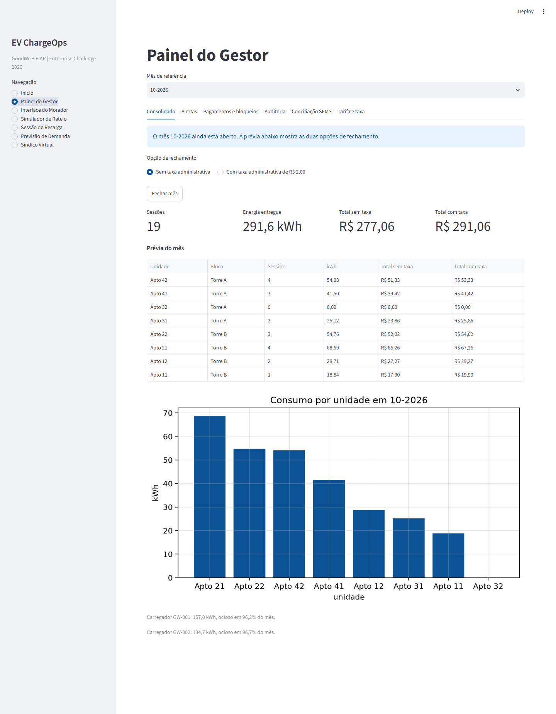
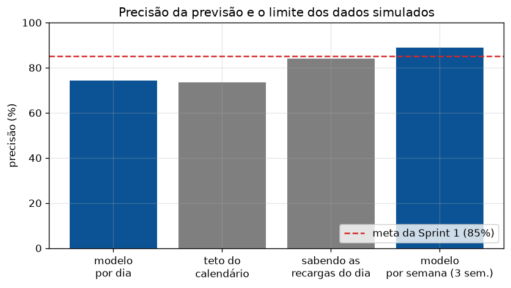
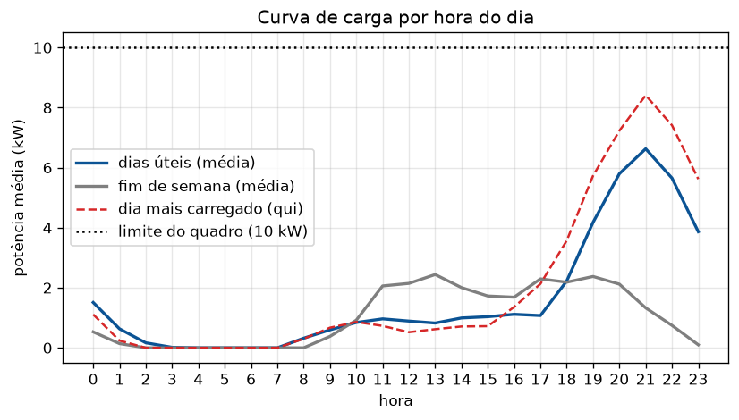
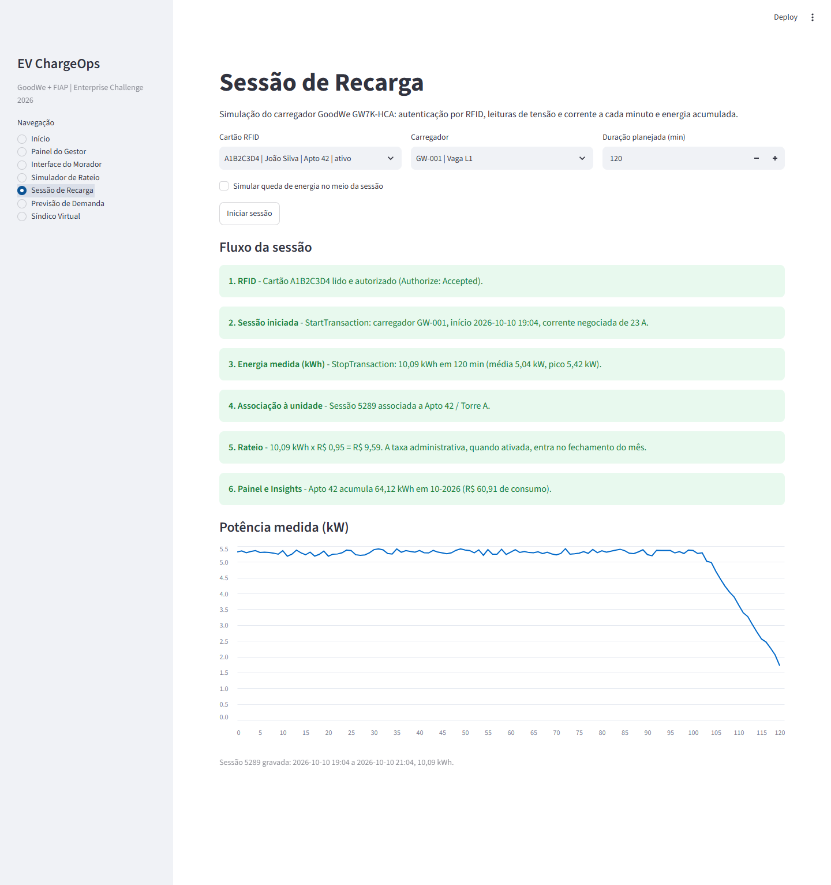
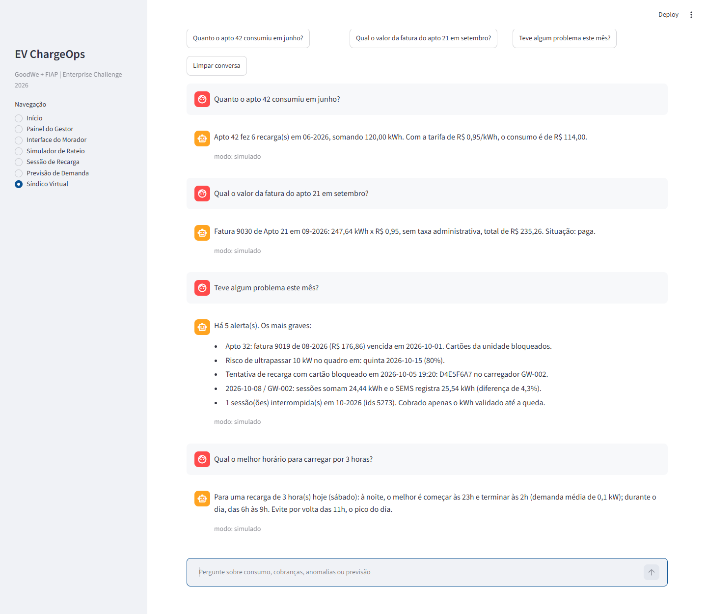

# EV ChargeOps — Enterprise Challenge 2026 (GoodWe + FIAP)

**Gestão inteligente de recargas compartilhadas.** Cada sessão de recarga vira uma cobrança justa, auditável e inteligente.

Este repositório é a entrega da Sprint 2: o protótipo funcional da solução definida na Sprint 1. A pesquisa, a arquitetura e o plano da Sprint 1 estão em [docs/sprint1_pesquisa.md](docs/sprint1_pesquisa.md).

> **Escopo acadêmico.** Este é um trabalho acadêmico do 1º ano de Ciência da Computação. As escolhas técnicas ficaram dentro do conteúdo abordado no curso até aqui, o que impõe limites ao protótipo e explica parte dos desvios descritos na seção 6.

| Integrante | RM |
|---|---|
| Pedro Matteo Benta dos Santos Simplicio | RM573133 |
| Christian Theodor Heisterkamp | RM571998 |
| Felippe Santos Roeder | RM571913 |
| Samuel Gissi Nogueira Gonçalves | RM568867 |
| Matheus Freitas da Silva Santos | RM574003 |

---

## 1. O que foi implementado

O protótipo cobre o fluxo completo de uma recarga em condomínio, do cartão RFID à cobrança mensal:

**RFID → Sessão iniciada → Energia medida (kWh) → Associação à unidade → Rateio → Painel e Insights**

- **Sessões de recarga** registradas com as grandezas do carregador GoodWe GW7K-HCA: tensão, corrente, potência e energia.
- **Consumo individual** por unidade, somando todos os cartões RFID do apartamento.
- **Rateio** pelo modelo da Sprint 1, `Fatura = Σ(E_sessao × T) + Tx_admin`, com fechamento mensal sem taxa ou com taxa administrativa.
- **Consolidado mensal, auditoria da fatura e bloqueio automático** dos cartões de quem tem fatura vencida.
- **Previsão de demanda e risco de sobrecarga** do quadro elétrico, com sugestão de janela de recarga fora do pico.
- **Síndico Virtual**, que responde em linguagem natural sobre consumo, cobranças e anomalias usando os dados do sistema.
- **Duas interfaces** sobre as mesmas regras: painel web para gestor e morador, e menu de console.

O carregador e o portal SEMS são simulados. Os dados do repositório são sintéticos e reproduzíveis: o gerador usa semente fixa, então a base sai igual em qualquer máquina.



---

## 2. Como executar

Requisito: Python 3.10 ou superior.

```bash
pip install -r requirements.txt
```

Os comandos são executados a partir da raiz do repositório.

| O que | Comando |
|---|---|
| Interface web (gestor e morador) | `streamlit run src/app_web.py` |
| Modo console | `python src/main.py` |
| Plano de testes, 51 cenários | `python src/verificacao.py` |
| Regerar os gráficos de evidência | `python src/gerar_evidencias.py` |
| Notebook executado | `notebooks/evidencias_ev_chargeops.ipynb` |

A base de demonstração já vem em `dados/`. Para recriá-la, use "Recriar a base de demonstração" no menu de simulação do console.

**Síndico Virtual com LLM (opcional).** Sem configuração ele roda em modo simulado. Para usar o `gpt-4o-mini`, defina a chave antes de executar:

```bash
set OPENAI_API_KEY=sua_chave        # Windows
export OPENAI_API_KEY=sua_chave     # Linux e macOS
```

---

## 3. Como a solução funciona

### 3.1 Sessão de recarga

O simulador segue o ciclo da norma IEC 61851-1 descrito na Sprint 1.

1. **Autenticação (Estado B).** O cartão é lido e autorizado pela regra `AUTORIZA = CARTAO_ATIVO AND NOT UNIDADE_INADIMPLENTE AND CARREGADOR_LIVRE`. Corresponde ao `Authorize` do OCPP.
2. **Carga (Estado C).** A cada minuto são lidas tensão (230 V) e corrente (20 a 30 A), e a potência é `P = V × I`. Nos últimos 15% da sessão a corrente cai, como ocorre com a bateria quase cheia. O início e o fim correspondem ao `StartTransaction` e ao `StopTransaction`.
3. **Energia.** A potência é integrada no tempo pelo método de Euler, `E[n+1] = E[n] + h × P[n]`, com passo de 1 minuto.
4. **Encerramento.** A sessão é gravada e associada à unidade pelo caminho cartão → usuário → unidade.

### 3.2 Rateio

```
Fatura = Σ(E_sessao × T) + Tx_admin
```

- `T` é a tarifa por kWh, única para qualquer horário. `Tx_admin` é a taxa administrativa. Os dois ficam em `dados/config.json` e são alterados pelo gestor na interface.
- **Com taxa ou sem taxa.** O gestor escolhe a opção ao fechar o mês. A prévia do mês aberto mostra os dois totais lado a lado, e cada fatura guarda a tarifa e a taxa usadas.

| Cenário | Conta | Total |
|---|---|---|
| Registro de exemplo da Sprint 1 (fatura 9001, sem taxa) | 120,0 kWh × R$ 0,95 | R$ 114,00 |
| Mesma tarifa, com taxa de R$ 2,00 | 12,4 kWh × R$ 0,95 + R$ 2,00 | R$ 13,78 |

### 3.3 Regras de negócio

| Regra | Implementação |
|---|---|
| Sessão interrompida | A energia gravada é a validada até a queda, e a fatura cobra só esse volume |
| Vários cartões por unidade | Até 10 cartões RFID somados na mesma fatura; o 11º é recusado no cadastro |
| Unidade sem recarga no mês | Entra no consolidado como `ISENTO`, com valor zero |
| Inadimplência | Fatura pendente e vencida bloqueia os cartões da unidade. A conferência é automática: ao abrir o sistema, após cada pagamento e na autorização de cada sessão |
| Consolidado mensal | Uma linha por unidade, com o total do mês |
| Auditoria | Refaz a conta a partir das sessões e compara com o valor gravado. Gestor e morador veem a mesma composição |

### 3.4 Dados

As seis tabelas da Sprint 1 (`Unit`, `User`, `RFID_Card`, `Charger`, `Session`, `Invoice`) foram mantidas com os mesmos nomes de campos, uma por arquivo JSON em `dados/`. Os registros de exemplo do documento da Sprint 1 existem na base com os mesmos valores: Apto 42 / Torre A, João Silva, cartão `A1B2C3D4`, carregador `GW-001`, sessão `5001` (18/06/2026, 19:00 às 22:30, 21,5 kWh) e fatura `9001` (06-2026, 120,0 kWh, R$ 114,00).

Campos acrescentados ao esquema original:

| Tabela | Campos | Para quê |
|---|---|---|
| `Session` | `potencia_media_kw`, `pico_kw`, `interrompida` | Curva de carga e alerta de sessão interrompida |
| `Invoice` | `tarifa`, `taxa_admin`, `sessoes`, `fechado_em`, `vencimento`, `pago_em` | Auditoria, opção com ou sem taxa, inadimplência |
| `Invoice.status` | valor `ISENTO`, além de `PENDING` e `PAID` | Unidade sem recarga no mês |

**Base de demonstração:** 8 unidades, 10 usuários, 10 cartões, 2 carregadores, 288 sessões de 01/06 a 09/10/2026 e 32 faturas de quatro meses fechados. No gerador (`src/model/carga_inicial.py`), cada unidade recarrega em 80% a 92% dos seus dias habituais e em 4% dos demais; cada sessão dura de 120 a 240 minutos, com corrente de 20 a 30 A; 8% das sessões são interrompidas.

---

## 4. Inteligência artificial

A IA faz parte do fluxo principal. A previsão alimenta o alerta de sobrecarga e a sugestão de horário, e o Síndico Virtual consulta as mesmas funções usadas pelas telas.

### 4.1 Previsão de demanda e detecção de padrões

Arquivo: `src/model/ia_previsao.py`.

1. **Série diária** da energia entregue, uma linha por dia.
2. **Entradas:** tendência, dia da semana (uma coluna 0/1 por dia), energia do dia anterior e média dos 7 dias anteriores.
3. **Avaliação temporal:** treino nos primeiros 80% dos dias e teste nos 20% finais.
4. **Modelos comparados:** regressão linear múltipla e Ridge, com `alpha` escolhido por validação cruzada. Fica o de menor RMSE no teste.
5. **Curva de carga:** matriz 7 × 24 com a potência média por dia da semana e hora, usada para sugerir a janela de menor demanda.
6. **Risco de sobrecarga:** regressão logística que estima a probabilidade de a demanda do dia ultrapassar o limite do quadro elétrico.

Resultados na base de demonstração (131 dias, 27 de teste):

| Modelo | MAE | RMSE | R² | Erro relativo |
|---|---|---|---|---|
| Regressão Linear (escolhido) | 9,25 kWh | 12,20 kWh | 0,454 | 25,7% |
| Ridge (alpha = 1) | 9,34 kWh | 12,27 kWh | 0,448 | 25,9% |

| Risco de sobrecarga | Acurácia | Precisão | Recall | F1 |
|---|---|---|---|---|
| Regressão logística | 73,7% | 85,7% | 40,0% | 0,545 |

**Precisão e limite dos dados.** A Sprint 1 definiu a meta de precisão acima de 85%, medida aqui como `1 − erro relativo`. O sistema compara o modelo com duas referências para mostrar de onde vem o erro:

| Cenário | Precisão | O que mostra |
|---|---|---|
| Modelo, por dia | 74,3% | Resultado do protótipo |
| Teto do calendário | 73,5% | Média real de cada dia da semana, com o histórico inteiro. É o máximo que um modelo baseado em calendário alcança nesses dados |
| Sabendo as recargas do dia | 84,0% | Quantidade de recargas conhecida de antemão, como em um agendamento |
| Modelo, por semana | 88,8% | A mesma previsão somada em blocos de 7 dias (3 semanas de teste) |

O modelo já atinge o teto do que o calendário explica. O erro restante vem de quais moradores recarregam em cada dia e de quanta energia cada recarga pede. Por semana a meta é superada, porque os erros diários se compensam. Com dados reais chegando continuamente, o modelo é treinado de novo com mais histórico e pode usar informações como agendamento e nível de bateria, e a apuração tende a melhorar. A meta diária precisa ser medida de novo com dados do carregador real.





### 4.2 Síndico Virtual

Arquivo: `src/model/sindico_virtual.py`. A resposta é montada por uma cadeia de três etapas:

1. **Classificar a intenção.** Prompt few-shot que devolve um JSON com `intencao`, `unidade` e `mes`.
2. **Executar a ferramenta local.** Uma função consulta os dados do sistema: consumo, fatura, comparação entre meses, anomalias, previsão, melhor horário, situação do cartão ou resumo do condomínio.
3. **Redigir a resposta.** O resultado da ferramenta entra no prompt como contexto, com a instrução de usar somente esses dados.

| Modo | Quando | Como funciona |
|---|---|---|
| LLM | `OPENAI_API_KEY` definida | As etapas 1 e 3 usam o `gpt-4o-mini`, com as últimas mensagens da conversa como memória |
| Simulado | Sem chave, sem internet ou quando a API falha | A intenção é reconhecida por palavras-chave e a resposta é montada com os mesmos dados |

Cada resposta informa o modo em que foi escrita. Exemplos do modo simulado, com a conversa completa em [evidencias/demo_sindico_virtual.txt](evidencias/demo_sindico_virtual.txt):

> **Pergunta:** Quanto o apto 42 consumiu em junho?
> **Resposta:** Apto 42 fez 6 recarga(s) em 06-2026, somando 120,00 kWh. Com a tarifa de R$ 0,95/kWh, o consumo é de R$ 114,00.

> **Pergunta:** O cartão do apto 32 está bloqueado?
> **Resposta:** Cartões de Apto 32: D4E5F6A7 (bloqueado). Há fatura vencida; o desbloqueio ocorre após o pagamento.

### 4.3 Alertas

Arquivo: `src/model/alertas.py`. As anomalias entram em uma fila de prioridade (heap máximo) e saem da mais grave para a mais leve: inadimplência, sobrecarga prevista, tentativa de uso com cartão bloqueado, divergência com o SEMS, sessão interrompida e carregador ocioso.

---

## 5. Arquitetura

O código segue o padrão MVC. As telas não contêm regra de negócio, e os modelos não leem nem escrevem na tela.

```
            VIEW                          CONTROLLER                         MODEL
  src/view/view_web.py      ->   src/controller/controle_gestor.py   ->   src/model/dados.py            (6 tabelas em JSON)
  src/view/view_console.py  ->   src/controller/controle_morador.py  ->   src/model/rateio.py           (fórmula, fechamento, auditoria, bloqueio)
  src/view/graficos.py      ->   src/controller/controle_sessao.py   ->   src/model/telemetria.py       (carregador simulado, SEMS)
                                 src/controller/controle_ia.py       ->   src/model/alertas.py          (fila de prioridade)
                                                                          src/model/ia_previsao.py      (IA: previsão e risco)
                                                                          src/model/sindico_virtual.py  (IA: assistente)
                                                                          src/model/carga_inicial.py    (base de demonstração)
```

Correspondência com o diagrama da Sprint 1 ([docs/Diagrama.svg](docs/Diagrama.svg)):

| Bloco da Sprint 1 | No protótipo |
|---|---|
| Carregador GoodWe e cartão RFID | `model/telemetria.py`, simulador do GW7K-HCA |
| Gateway IoT local e plataforma SEMS+ | Leituras do simulador e `dados/sems_export.json`, com conciliação |
| Camada de aplicação EV ChargeOps | `controller/` |
| Banco de dados | `model/dados.py` e `dados/*.json` |
| Regras de rateio | `model/rateio.py` |
| Módulos de IA | `model/ia_previsao.py` e `model/sindico_virtual.py` |
| Painel do gestor e interface do morador | `view/view_web.py` e `view/view_console.py` |

```
GoodWe-EV-ChargeOps/
├── README.md
├── requirements.txt
├── link_repositorio.txt
├── docs/                          documento e diagrama da Sprint 1
├── dados/                         base de demonstração (JSON, CSV e log)
├── src/
│   ├── app_web.py                 entrada da interface web
│   ├── main.py                    entrada do modo console
│   ├── verificacao.py             plano de testes
│   ├── gerar_evidencias.py        gráficos e conversa de demonstração
│   ├── formato.py                 formatação de números e valores em reais
│   ├── model/                     dados, rateio, telemetria, alertas, IA
│   ├── controller/                gestor, morador, sessão, IA
│   └── view/                      web, console e gráficos
├── notebooks/                     notebook executado
└── evidencias/                    capturas de tela, gráficos e saídas
```

Tecnologias: Python, pandas, NumPy, scikit-learn, matplotlib, Streamlit e a API da OpenAI (opcional).

---

## 6. Da Sprint 1 à Sprint 2

**Mantido como planejado:** a fórmula do rateio, a tarifa única por kWh, a taxa administrativa opcional, as regras auxiliares, o esquema de seis tabelas, o ciclo de sessão IEC 61851 e as duas frentes de IA.

### Desvios e justificativas

| Planejado na Sprint 1 | Implementado | Justificativa |
|---|---|---|
| Banco de dados relacional | Arquivos JSON, um por tabela, com os mesmos campos e chaves | O protótipo roda sem instalar nem configurar um servidor de banco. O acesso aos dados fica isolado em um módulo, então a troca por SQL não afeta as regras |
| APIs REST de usuários e unidades | Controllers em Python, usados pelas duas interfaces e pelo Síndico Virtual | O protótipo é local e não tem cliente externo para consumir a API. Os controllers já expõem as mesmas operações e são o ponto em que a API seria publicada |
| Decodificação Modbus via gateway IoT | Simulador do GW7K-HCA, com leituras por minuto | Sem acesso ao carregador fora do laboratório. O simulador produz as mesmas grandezas que a leitura Modbus entregaria |
| Ingestão agendada do SEMS Portal | Export diário simulado e conciliação com erro absoluto e relativo | Sem credenciais da API do portal. A conciliação, que é o objetivo da integração, está implementada |
| Prophet para séries temporais | Regressão linear e Ridge com variáveis de calendário e defasagem; regressão logística para o risco | Com quatro meses de histórico e padrão semanal, o modelo linear é interpretável e já atinge o teto de previsibilidade dos dados (seção 4.1). Modelos baseados em calendário, como o Prophet, tendem a esbarrar no mesmo teto |
| Painel web do gestor | Interface web em Streamlit | Entrega o painel em Python, sem um front-end separado, com uma única base de código |
| Aplicativo mobile do morador | Página do morador na interface web | A página abre no navegador do celular. O aplicativo nativo fica como evolução |

### Plano de desenvolvimento, fase a fase

| Fase planejada | Entregue |
|---|---|
| 1. Infraestrutura de dados | As seis tabelas com o mesmo esquema e os controllers de cadastro de unidade, usuário e cartão |
| 2. Protocolos e telemetria | Simulador do carregador e conciliação diária com o export do SEMS |
| 3. Regras financeiras e motores de IA | Rateio com fechamento mensal, auditoria e bloqueio; previsão de demanda e risco de sobrecarga; Síndico Virtual |
| 4. Interfaces e validação | Interface web com sete páginas, modo console e plano de testes com 51 cenários |

### Indicadores definidos na Sprint 1

| Indicador | Meta | Resultado | Como foi medido |
|---|---|---|---|
| Precisão do faturamento | 100% | 100% | Auditoria das 32 faturas fechadas: todas conferem com as sessões |
| Precisão do modelo preditivo | > 85% | 74,3% por dia e 88,8% por semana | Período de teste com dados simulados (seção 4.1) |
| Disponibilidade da plataforma | > 99% | Não medido | Exige operação contínua |
| Margem de erro de leitura RFID | < 1% | Não medido | Exige o leitor físico do carregador |

Os indicadores também aparecem na página inicial da interface web e no menu do gestor do console.

---

## 7. Decisões técnicas

- **MVC com duas interfaces.** Telas, coordenação e regras ficam separadas. A mesma função de rateio atende a interface web e o console.
- **Taxa administrativa por fechamento.** A Sprint 1 trata a taxa como opcional. A escolha é feita pelo gestor a cada fechamento, e a fatura registra a tarifa e a taxa aplicadas, o que mantém as faturas antigas auditáveis mesmo se a configuração mudar.
- **Bloqueio conferido em três momentos.** Ao abrir o sistema, após cada pagamento e na autorização de cada sessão, para que o bloqueio não dependa de uma ação manual.
- **Assistente ancorado em dados.** O Síndico Virtual não responde de memória: uma função consulta o sistema, e o modelo de linguagem só redige com o que recebeu. O modo simulado garante o funcionamento sem chave e sem internet.
- **Avaliação temporal do modelo.** Treino no passado e teste no futuro, sem embaralhar os dias. O resultado é reportado junto com o limite dos dados.
- **Base reproduzível.** Gerador com semente fixa, para que testes, gráficos e métricas se repitam em qualquer máquina.
- **Tratamento de falhas externas.** Entradas do usuário são validadas antes do uso. A chamada à API da OpenAI tem limite de espera e cai para o modo simulado em caso de erro.

---

## 8. Evidências de funcionamento

| Evidência | Arquivo |
|---|---|
| Plano de testes, 51 cenários com resultado esperado e obtido | [evidencias/verificacao_saida.txt](evidencias/verificacao_saida.txt) |
| Sessão completa no console: gestor, morador, simulação e IA | [evidencias/console_demonstracao.txt](evidencias/console_demonstracao.txt) |
| Notebook executado, com tabelas e gráficos | [notebooks/evidencias_ev_chargeops.ipynb](notebooks/evidencias_ev_chargeops.ipynb) |
| Conversa com o Síndico Virtual | [evidencias/demo_sindico_virtual.txt](evidencias/demo_sindico_virtual.txt) |

Capturas da interface web:

| Tela | Arquivo |
|---|---|
| Início, com o fluxo de seis etapas, alertas e indicadores | [web_01_inicio.png](evidencias/web_01_inicio.png) |
| Gestor: mês aberto, opções com taxa e sem taxa | [web_02_gestor_mes_aberto_com_e_sem_taxa.png](evidencias/web_02_gestor_mes_aberto_com_e_sem_taxa.png) |
| Gestor: consolidado de junho | [web_03_gestor_consolidado_junho.png](evidencias/web_03_gestor_consolidado_junho.png) |
| Gestor: auditoria da fatura 9001 | [web_04_gestor_auditoria_fatura_9001.png](evidencias/web_04_gestor_auditoria_fatura_9001.png) |
| Gestor: alertas por prioridade | [web_05_gestor_alertas.png](evidencias/web_05_gestor_alertas.png) |
| Gestor: pagamentos e bloqueios | [web_06_gestor_pagamentos_bloqueios.png](evidencias/web_06_gestor_pagamentos_bloqueios.png) |
| Gestor: conciliação com o SEMS | [web_07_gestor_conciliacao_sems.png](evidencias/web_07_gestor_conciliacao_sems.png) |
| Gestor: tarifa e taxa | [web_08_gestor_tarifa_e_taxa.png](evidencias/web_08_gestor_tarifa_e_taxa.png) |
| Morador: Apto 42 em junho, com a fatura auditada | [web_09_morador_apto42_junho.png](evidencias/web_09_morador_apto42_junho.png) |
| Simulador de rateio, sem taxa | [web_10_simulador_exemplo_sprint1.png](evidencias/web_10_simulador_exemplo_sprint1.png) |
| Simulador de rateio, com taxa | [web_11_simulador_exemplo_pitch.png](evidencias/web_11_simulador_exemplo_pitch.png) |
| Sessão de recarga, com as seis etapas e a curva de potência | [web_12_sessao_de_recarga.png](evidencias/web_12_sessao_de_recarga.png) |
| Previsão de demanda | [web_13_previsao_de_demanda.png](evidencias/web_13_previsao_de_demanda.png) |
| Síndico Virtual | [web_14_sindico_virtual.png](evidencias/web_14_sindico_virtual.png) |

Gráficos: [consumo_diario.png](evidencias/consumo_diario.png), [curva_carga_horaria.png](evidencias/curva_carga_horaria.png), [previsao_vs_real.png](evidencias/previsao_vs_real.png), [residuos.png](evidencias/residuos.png), [previsao_7_dias.png](evidencias/previsao_7_dias.png), [limite_dos_dados.png](evidencias/limite_dos_dados.png), [ranking_unidades.png](evidencias/ranking_unidades.png) e [potencia_sessao.png](evidencias/potencia_sessao.png).





---

## 9. Limitações e próximos passos

- **Carregador e SEMS simulados.** O próximo passo é ler o equipamento real por Modbus/RS-485 e coletar os dados pela API do portal. A troca fica restrita ao módulo de telemetria.
- **Persistência em arquivos.** Atende a um condomínio pequeno. Na base de demonstração as telas respondem em menos de 0,1 s; com volume maior, o esquema deve ir para um banco relacional.
- **Modelo preditivo.** Avaliado com quatro meses de dados sintéticos. A precisão diária precisa ser medida de novo com dados reais.
- **Sessão registrada após o fechamento.** Aparece como divergência na auditoria; falta o fluxo de fatura complementar.
- **Autenticação.** O protótipo permite escolher o perfil de gestor ou de morador sem senha.

## 10. Uso de IA no desenvolvimento

Ferramentas de IA generativa foram usadas durante o desenvolvimento, para gerar e revisar trechos de código e de documentação, como o enunciado permite. As decisões de arquitetura e de regra de negócio estão descritas nas seções 6 e 7.

O sistema não depende de IA externa para funcionar. Sem chave de API ele roda completo, com o Síndico Virtual em modo simulado; o rateio, a telemetria, os alertas e a previsão de demanda rodam localmente.
