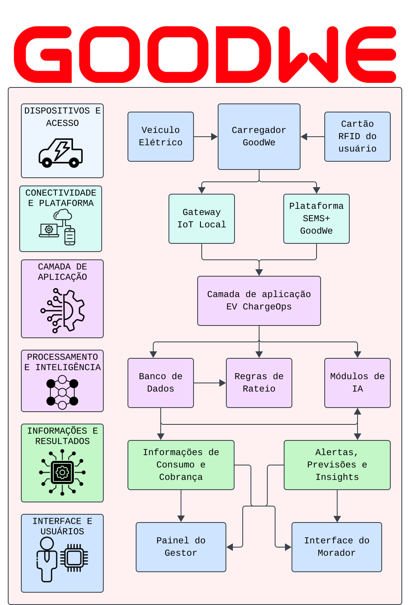

# EV ChargeOps — Enterprise Challenge 2026

## Integrantes do Grupo

| [Pedro Matteo Benta dos Santos Simplicio] | RM573133 |
| [Christian Theodor Heisterkamp]           | RM571998 |
| [Samuel Gissi Nogueira Gonçalves]         | RM568867 |
| [Matheus Freitas da Silva Santos]         | RM574003 |

---

## 1. Descrição do Problema e Contexto do Desafio

A GoodWe é uma das maiores fabricantes globais de inversores fotovoltaicos, sistemas de armazenamento de energia e soluções para mobilidade elétrica. No Brasil, em parceria com a FIAP por meio do Energy Innovation Lab, disponibiliza o carregador de veículos elétricos HCA G2 para fins acadêmicos e de pesquisa aplicada.

O projeto **EV ChargeOps** foi concebido para transformar dados operacionais em inteligência de gestão, oferecendo controle financeiro, monitoramento operacional e suporte à tomada de decisão por meio de análise de dados e Inteligência Artificial.

### Objetivo da Solução

Desenvolver uma plataforma capaz de:

* Monitorar sessões de recarga;
* Identificar usuários através de RFID;
* Calcular o consumo individual de energia;
* Gerar cobranças automatizadas;
* Fornecer informações gerenciais para administradores de condomínios.

---

## 2. Proposta de Valor

* Gestão de recargas compartilhadas
* Rateio individualizado de consumo
* Controle de acesso via RFID
* Dashboard administrativo
* Assistente inteligente para consultas
* Previsão de demanda baseada em Machine Learning

### Diferenciais Competitivos

* Foco em condomínios brasileiros
* Compatibilidade com equipamentos GoodWe
* Cobrança individualizada por unidade
* Bloqueio automático de inadimplentes
* Integração com processos condominiais

---

## 3. Frentes de Pesquisa e Documentação (Sprint 01)

### Frente 1 — Contexto e Problema

As infraestruturas de recarga compartilhada são sistemas que viabilizam o abastecimento coletivo de veículos elétricos. Os principais desafios operacionais mapeados para gestores de condomínios, edifícios corporativos e campi universitários envolvem:

* Estabilidade da infraestrutura de internet local
* Padronização de plugues e conectores
* Garantia de um custeio justo e individualizado entre os usuários
* Integração sistêmica entre os softwares do fornecedor e as empresas de monitoramento
* Conflitos de convivência decorrentes do uso de vagas compartilhadas
* Limitações de infraestruturas elétricas antigas sujeitas a sobrecarga
* Escassez de mão de obra especializada para manutenção corretiva e preventiva

### Análise de Modelos de Negócio Existentes

1. **Recarga Gratuita:** O estabelecimento comercial assume integralmente os custos da energia elétrica para atrair proprietários de VEs, aumentando o tempo de permanência no local e fidelizando clientes.
2. **Cobrança por Energia Consumida:** O usuário é tarifado de maneira exata com base na quantidade de quilowatts-hora (kWh) injetados na bateria do veículo.
3. **Cobrança por Tempo de Sessão:** A tarifação é calculada pelo período em que o automóvel permanece conectado fisicamente ao carregador, independentemente do volume de energia transferido.
4. **Assinatura Mensal ou Planos Recorrentes:** O motorista paga uma taxa fixa mensal para garantir uma franquia de energia ou recargas ilimitadas dentro de uma rede credenciada de estações.
5. **Rateio Condominial Exato:** Os carregadores são alocados em áreas comuns. Cada morador utiliza uma tag RFID ou aplicativo individual e, ao final do mês, a plataforma consolida o consumo por apartamento, lançando o valor diretamente na cota condominial da unidade.

### Benchmarking de Mercado (Soluções Similares)

* **ChargePoint:** Oferece uma infraestrutura corporativa escalável com gestão integrada de hardware/software, relatórios de ESG e balanceamento de carga. Opera via venda de hardware associada a planos SaaS (ChargePoint as a Service) e comissionamento. Possui alta dependência de ecossistema proprietário e elevado investimento inicial.

* **NeoCharge:** Soluciona a complexidade do multiuso gerenciando estações de múltiplos fabricantes por meio do protocolo aberto OCPP. Disponibiliza aplicativo para o usuário, dashboard corporativo e individualização de cobrança. Apresenta desafios eventuais de interoperabilidade com marcas específicas de veículos ou inversores importados.

* **Wallbox:** Focada em carregadores inteligentes residenciais e condominiais que evitam obras civis caras por meio de balanceamento entre múltiplos carregadores e agendamento em horários de tarifa barata. Monetiza via hardware e planos de gestão na plataforma myWallbox, contudo possui limitações nativas para automações financeiras complexas (como emissão de boletos).

---

### Frente 2 — Base Regulatória e Técnica

#### Resolução Normativa ANEEL nº 1000/2021

Dedica o Título III, Capítulo V (Art. 544), à regulamentação da exploração comercial da atividade de recarga de veículos elétricos, permitindo a prática a preços livremente negociáveis. O Art. 550 impõe a obrigatoriedade de comunicar a instalação de estações de recarga à distribuidora local em casos de nova conexão, aumento/redução de carga ou alteração de nível de tensão, exigindo também a compatibilidade com protocolos abertos de domínio público para comunicação e controle. Os custos associados seguem o Art. 551, delimitando as responsabilidades de adequação interna ao consumidor (Art. 98) e de substituição de infraestruturas da rede externa à distribuidora (Art. 101).

#### Legislação Estadual de São Paulo (Lei nº 18.403/2026)

Garante o direito de instalação de estações de recarga individualizadas em condomínios comerciais e residenciais, mitigando reprovações arbitrárias por parte de convenções condominiais. A legislação estadual exige a conformidade estrita com as normas técnicas da ABNT, diretrizes da distribuidora local e execução obrigatória por profissional habilitado munido de ART ou RRT.

#### Interfaces Técnicas do Carregador GoodWe HCA G2

| Interface                       | Descrição                                                                                                                                                                                                                                                    |
| ------------------------------- | ------------------------------------------------------------------------------------------------------------------------------------------------------------------------------------------------------------------------------------------------------------ |
| **RS-485**                      | Barramento industrial que permite a transmissão física de dados por distâncias de até 1200 metros com múltiplos dispositivos, viabilizando a coleta centralizada de dados de inversores, smart meters, baterias e carregadores para relatórios consolidados. |
| **LAN e Wi-Fi** (Alcance < 15m) | Interfaces de rede locais que transmitem telemetria de desempenho, alarmes e dados operacionais para os servidores de nuvem de forma ágil.                                                                                                                   |
| **Bluetooth** (Alcance < 10m)   | Padrão de comunicação de curto alcance empregado para parametrização inicial do hardware e manutenção de campo na ausência de rede de internet ativa.                                                                                                        |
| **RFID**                        | Tecnologia de identificação por radiofrequência por meio de cartões magnéticos passivos, associando o consumo elétrico, tempo de uso e sessões a usuários específicos.                                                                                       |

#### Exploração da API GoodWe (SEMS Portal)

O portal SEMS+ coleta e segrega os indicadores operacionais em tempo real:

* **Interface das Plantas:** Listagem de plantas, monitoramento de energia diária, balanço energético (geração solar vs. consumo da rede concessionária) e históricos anuais.
* **Interface do Dispositivo:** Dados detalhados de hardware, curvas de potência e alarmes de falha.
* **Controle Remoto:** Ajustes de relógio de tempo real (RTC), gerenciamento de EMS e limites de exportação.

---

## 4. Frente 3 — Arquitetura e Inteligência Artificial

### Funcionamento Técnico de uma Sessão de Recarga

O ciclo de vida de uma sessão de recarga de veículos elétricos segue quatro etapas lógicas estritas em conformidade com as normas técnicas vigentes:

```
[Estado A: 12V] -> Cabo conectado (Pino PP lê a capacidade óhmica do cabo)
        |
[Estado B: 9V]  -> Detecção do EV (Pino CP fecha circuito com o resistor do carro)
        |          Autenticação via RFID / OCPP (Aprovação Accepted pelo CSMS)
        |
[Estado C: 6V]  -> Handshake PWM (Onda de 1kHz define Duty Cycle da corrente limite)
        |          Fechamento dos contatores mecânicos -> Início da Carga
        |
[Encerramento]  -> Consumo zerado pelo veículo -> Abertura dos contatores
                   Envio de StopTransaction -> Liberação mecânica do plugue
```

**1. Conexão Física e Reconhecimento de Hardware (Plug):** O sistema mantém as linhas de potência isoladas por segurança. O veículo lê a resistência elétrica no pino PP (Proximity Pilot) para identificar a capacidade de corrente do cabo. Paralelamente, a estação injeta 12V contínuos no pino CP (Control Pilot). Ao acoplar o carro, um resistor interno fecha circuito com o pino PE (Terra), derrubando a tensão para 9V (Estado B conforme a norma IEC 61851-1), sinalizando a presença física do veículo.

**2. Autenticação de Usuário e Autorização de Rede (OCPP):** Em Estado B, o carregador permanece travado. O usuário aproxima o cartão RFID ou envia um comando via app. A estação encapsula o UID do cartão e envia uma mensagem `Authorize.req` ao servidor central (CSMS). Após a validação de saldo e cadastro, o servidor retorna um `Authorize.conf` com o status `Accepted`, liberando logicamente o carregador.

**3. Negociação de Parâmetros e Handshake de Controle (PWM):** O circuito oscilador converte o sinal de 9V do pino CP em uma onda quadrada de 1kHz usando Modulação por Largura de Pulso (PWM). O ciclo de trabalho (duty cycle) dessa onda informa eletronicamente ao veículo qual a corrente máxima que a rede local suporta. O carregador de bordo (OBC) lê essa informação e, estando pronto, ativa um segundo resistor em paralelo, derrubando a crista da onda de 9V para 6V (Estado C), acionando os contatores mecânicos para iniciar a transferência de energia alternada (L1, L2, L3 e N). Simultaneamente, a estação dispara um `StartTransaction.req` via OCPP para registrar o timestamp e a leitura inicial do medidor em Watts-hora (Wh).

**4. Encerramento da Sessão e Desconexão Segura:** Disparado por saturação da bateria (100% SoC), comando do usuário ou pelo veículo. O carro zera o consumo de corrente para evitar arcos elétricos destrutivos, os contatores da estação se abrem desenergizando o cabo, e uma mensagem `StopTransaction.req` é enviada para computar o consumo acumulado. O atuador eletromecânico libera a trava do plugue para remoção segura.

---

### Camadas da Plataforma EV ChargeOps

Para suprir as limitações de conectividade e a falta de integração nativa com o protocolo OCPP no hardware GoodWe HCA G2, a arquitetura do EV ChargeOps adota uma solução híbrida de monitoramento industrial, viabilizando a coleta de dados via Modbus/RS-485 e garantindo a centralização da gestão de recargas.

| Camada                | Descrição                                                                                                                                                                                                                                                                                                                     |
| --------------------- | ----------------------------------------------------------------------------------------------------------------------------------------------------------------------------------------------------------------------------------------------------------------------------------------------------------------------------- |
| **Física (Hardware)** | Composta pelo carregador **GoodWe GW7K-HCA** (Monofásico, 7 kW, 230V, cabo de 6m IEC Tipo 2, proteção IP66 e detecção de corrente residual RCD Tipo A + 6mA CC). Suporta autenticação local offline para até 10 cartões RFID pré-cadastrados.                                                                                 |
| **Conectividade**     | Comunicação local via Wi-Fi, Bluetooth e barramento físico industrial RS-485. Utiliza o protocolo industrial **Modbus** para comunicação entre o carregador, smart meter e inversores.                                                                                                                                        |
| **Aplicação**         | Os dados de telemetria brutos são capturados em tempo real por um gateway IoT local via Modbus e, de forma periódica, validados através de integração direta com as interfaces da plataforma em nuvem **SEMS Portal** da GoodWe para auditoria. Centraliza as regras de negócio de faturamento e o bloqueio de inadimplentes. |
| **Apresentação**      | Composta pelo Painel Administrativo Web (voltado para gestão e emissão de relatórios consolidados por síndicos) e pelo Aplicativo do Usuário Morador (focado no acompanhamento de consumo individual em kWh e alertas).                                                                                                       |

### Diagrama de Arquitetura da Solução Proposta



### Papel da IA na Solução

A Inteligência Artificial atua como o núcleo analítico e de interface da plataforma através de duas frentes principais:

1. **Análise Preditiva e Detecção de Padrões (Machine Learning):** Emprega modelos de aprendizado de máquina para séries temporais (Scikit-Learn e Prophet) focados em analisar horários de conexão, frequência de recarga e ociosidade de vagas. O objetivo é prever gargalos na infraestrutura elétrica do condomínio, sugerindo automaticamente janelas otimizadas fora do horário de pico para evitar sobrecargas.

2. **Síndico Virtual (Agente Conversacional NLP):** Interface conversacional baseada em processamento de linguagem natural destinada a traduzir dados complexos de engenharia, logs operacionais e relatórios de faturamento em respostas gerenciais claras e interativas em formato de chat.

### Modelo de Rateio Proposto

O faturamento opera sob a política de uso real (*pay-per-use*), utilizando medidores inteligentes que geram as mensagens de consumo bruto via registros industriais. O cálculo individualizado é regido pela equação:

$$Fatura = \sum(E_{sessao} \times T) + Tx_{admin}$$

**Onde:**

| Variável   | Descrição                                                              |
| ---------- | ---------------------------------------------------------------------- |
| `Fatura`   | Valor monetário final lançado no boleto da unidade                     |
| `E_sessao` | Integral da energia elétrica transferida na sessão (kWh)               |
| `T`        | Tarifa vigente da concessionária local de energia (R$/kWh)             |
| `Tx_admin` | Taxa de manutenção opcional configurada pela administração condominial |

**Regras Auxiliares:**

* Em sessões interrompidas abruptamente, cobra-se estritamente o volume validado até a queda.
* O sistema unifica múltiplos UIDs de cartões RFID (até 10) sob o ID de uma única unidade habitacional.
* Pendências financeiras resultam no bloqueio lógico binário da tag no banco de dados.

### Indicadores de Desempenho (KPIs)

| Indicador                          | Meta  |
| ---------------------------------- | ----- |
| Precisão do faturamento            | 100%  |
| Disponibilidade da plataforma      | > 99% |
| Margem de erro de leitura RFID     | < 1%  |
| Precisão do modelo preditivo de IA | > 85% |

---

## 5. Esquema Relacional da Base de Dados

Modelo de persistência de dados estruturado para garantir a integridade, rastreabilidade financeira e fornecimento de dados históricos para os modelos de IA:

| Tabela        | Atributos (Tipos)                                                                                                      | Exemplo de Registro                                                                                                                     |
| ------------- | ---------------------------------------------------------------------------------------------------------------------- | --------------------------------------------------------------------------------------------------------------------------------------- |
| **Unit**      | `id` (PK), `name` (String), `block` (String)                                                                           | id: 1, name: "Apto 42", block: "Torre A"                                                                                                |
| **User**      | `id` (PK), `unit_id` (FK), `name` (String), `email` (String)                                                           | id: 101, unit_id: 1, name: "João Silva", email: "[joao@email.com](mailto:joao@email.com)"                                               |
| **RFID_Card** | `uid` (PK), `user_id` (FK), `status` (Boolean)                                                                         | uid: "A1B2C3D4", user_id: 101, status: true                                                                                             |
| **Charger**   | `id` (PK), `model` (String), `max_power_kw` (Float), `location` (String)                                               | id: "GW-001", model: "GW7K-HCA", max_power_kw: 7.0, location: "Vaga L1"                                                                 |
| **Session**   | `id` (PK), `rfid_uid` (FK), `charger_id` (FK), `start_time` (Datetime), `end_time` (Datetime), `kwh_delivered` (Float) | id: 5001, rfid_uid: "A1B2C3D4", charger_id: "GW-001", start_time: "2026-06-18 19:00", end_time: "2026-06-18 22:30", kwh_delivered: 21.5 |
| **Invoice**   | `id` (PK), `unit_id` (FK), `month` (String), `total_kwh` (Float), `total_value` (Float), `status` (String)             | id: 9001, unit_id: 1, month: "06-2026", total_kwh: 120.0, total_value: 114.00, status: "PENDING"                                        |

---

## 6. Plano de Desenvolvimento (Sprint 02)

* **Fase 1 — Infraestrutura de Dados:** Implantação física do banco de dados relacional baseado no esquema estruturado e desenvolvimento das APIs REST para controle de usuários e unidades.
* **Fase 2 — Protocolos e Telemetria:** Implementação dos scripts de decodificação de dados Modbus via Gateway IoT e rotinas de ingestão agendada via API do SEMS Portal para consolidação histórica de sessões.
* **Fase 3 — Regras Financeiras e Motores de IA:** Codificação dos algoritmos automáticos de rateio monetário, treinamento inicial do modelo preditivo Prophet para séries temporais e arquitetura do fluxo NLP para o Síndico Virtual.
* **Fase 4 — Interfaces e Validação:** Construção das telas responsivas do Painel Web do Gestor, interface mobile do Morador e execução de testes integrados ponta a ponta.

---

## 7. Referências Bibliográficas

AGÊNCIA NACIONAL DE ENERGIA ELÉTRICA (Brasil). *Resolução Normativa ANEEL nº 1.000, de 7 de dezembro de 2021.* Estabelece as Regras de Prestação do Serviço Público de Distribuição de Energia Elétrica. Brasília: ANEEL, 2021.

SÃO PAULO (Estado). Assembleia Legislativa. *Lei nº 18.403, de 18 de fevereiro de 2026.* Dispõe sobre o direito à instalação de estação de recarga individual para veículos elétricos em edificações residenciais e comerciais no Estado. Diário Oficial do Estado de São Paulo, 2026.

GOODWE. *Linha HCA G2 Carregador CA: ficha técnica.* GoodWe Technologies Co., Ltd., 2024.

GOODWE Solar Academy. *2024 Documento Técnico*, 2024.

INTERNATIONAL ELECTROTECHNICAL COMMISSION. *IEC 61851-1: Electric vehicle conductive charging system - Part 1: General requirements.* Geneva: IEC, 2017.

INTERNATIONAL ELECTROTECHNICAL COMMISSION. *IEC 62196-2: Plugs, socket-outlets, vehicle connectors and vehicle inlets - Conductive charging of electric vehicles.* Geneva: IEC, 2022.

OPEN CHARGE ALLIANCE. *OCPP 1.6 Compliancy Test Tool: Test Case Document.* Arnhem: OCA, 2024.

ASSOCIAÇÃO BRASILEIRA DE NORMAS TÉCNICAS. *NBR 17019: Instalações elétricas de baixa tensão - Alimentação de veículos elétricos.* Rio de Janeiro: ABNT, 2022.

ASSOCIAÇÃO BRASILEIRA DE NORMAS TÉCNICAS. *NBR 5410: Instalações elétricas de baixa tensão.* Rio de Janeiro: ABNT, 2004.

CHARGEPOINT. *ChargePoint as a Service.* Campbell, CA, 2026.

NEOCHARGE. *O que é o Protocolo OCPP e qual sua importância para a recarga de veículos elétricos?* São Paulo, 2025.

WALLBOX. *MyWallbox App: smart charging management.* Barcelona, 2026.

GUSE, Rosana. *O que é RS-485?* MakerHero, 2024.

TOTVS. *O que é RFID, como usar a tecnologia e sua importância*, 2026.
